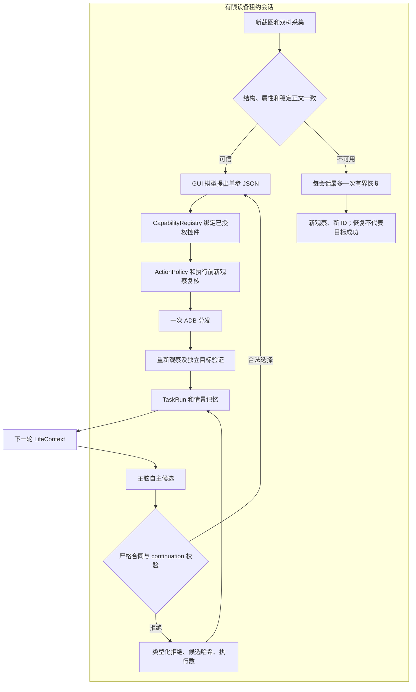

# v0.2.2 Reliability Closure：实现与运行契约

本轮只修复 Phase 1.2.1 的三个缺口。实际验收状态见同目录 `PHASE1_2_1_CLOSURE_REPORT.md`；实现完成不代表真实自主验收通过。旧 v0.2.1 报告、原始失败、ZIP 和 wheel 保留原样。

## 逐文件变更

| 文件 | 作用 |
| --- | --- |
| src/phonelife/semantic_stability.py（新增） | 程序拥有的 Uptime 证据识别、逻辑窗口/结构比较、局部像素规则 |
| src/phonelife/semantic.py | 分级可信状态、差异审计、采集样本/时间/独立帧元数据、分类冷却、动态内容进展过滤 |
| src/phonelife/semantic_recovery.py（新增） | 有租约、限时、限次、不重放触屏的恢复控制器 |
| src/phonelife/capabilities.py | 动态可信的稳定目标复验、固定恢复 launch 的能力检查 |
| src/phonelife/devices.py | QEMU 再校验和固定 Settings 主界面重开指令 |
| src/phonelife/loop.py | 会话内恢复入口、未知传输状态、类型化拒绝进入 TaskRun、采样审计作用域的建立与释放 |
| src/phonelife/semantic_storage.py | 双树附加帧及独立验证重复采样的私有保存/不可变事件；不迁移或回填旧行 |
| src/phonelife/verification_registry.py | 支持经稳定性检查的动态可信观察，保留原目标谓词和成功限制 |
| src/phonelife/decision_errors.py（新增） | 结构化原因、候选摘要及拒绝异常契约 |
| src/phonelife/brain.py | 有界类型化修复、实际输入/上下文哈希、历史拒绝引用审计 |
| src/phonelife/autonomy.py | 失败及同轮修复成功的拒绝进入情景记忆和下一轮上下文 |
| src/phonelife/audit.py | 类型分类、标识符和安全布尔保护、凭证/个人标识/字典键脱敏 |
| src/phonelife/__init__.py、pyproject.toml、semantic_benchmark.py | 版本和基准元数据更新至 0.2.2 |
| tests/test_closure.py、tests/fixtures/uptime-api35/ | 36 项离线回归及脱敏真实树形 fixture，原测试文件不变 |
| README.md、本契约、验收报告 | 当前运行说明、架构约束与真实验收边界 |

精确 SHA 和差异见 `data/phase122/changed-files.json` / `implementation.patch`。新增有限验证工具位于 `data/phase122/`，不属于常驻运行入口；不改变原 persona。helper Java/JAR、storage schema 与旧文档均未修改。

## 根因与复现

1. 原模拟器从 About emulated device 合法滚动两次后，四次采集产生三对对照：控件数量和属性不变，唯一变化是 `android:id/summary` 的 Uptime 数字文本（例如两次采集相隔约两秒）。三对树 SHA 和旧正文采样均不相等。原始数据在 `data/phase122/deep-reproduction/`，含树、PNG、采集时间、原始判断及实际输入；这些材料为私有。早先未滚动的四次对照完全稳定，单独保存在 `reproduction/`。不能把所有 backend 错误都归因于 Uptime：UIAutomator idle 失败和冷却是独立事件。
2. 用冻结 v0.2.1 源码执行确定性双周期 fixture，主脑两次缺少 continuation 引用后，审计有具体拒绝，下一轮上下文没有具体拒绝。见 `data/phase122/decision-reproduction.json`。这是离线因果复现，与真实自主证据分别报告。
3. 旧通用脱敏把 `password: false` 当密码内容遮盖；手机号正则还可能匹配摘要或标识符中的数字片段。旧证据不回填或重写。

`tests/fixtures/uptime-api35/` 保留脱敏后的真实树形状和原树哈希，像素由测试生成；原始私人截图不进入源码包。`test_closure.py` 证明旧精确比较会失败、新规则只容忍已识别区域。

## 语义稳定性

| 项目 | v0.2.1 | v0.2.2 |
| --- | --- | --- |
| 树 | 所有文本和属性完全相等 | 结构和安全属性完全相等；唯一特许是可信 Uptime summary 文本 |
| 图片 | 正文缩小采样完全相等 | 正文 RGB 精确比较，仅遮盖程序验证的展示边界及 2px padding |
| 窗口 | 根窗口和覆盖层检查 | 加上逻辑窗口类型、active、bounds、root package/class 对照 |
| 状态 | trusted / partial / unavailable | 保留 trusted（稳定）；新增 trusted_dynamic_noninteractive |
| 执行前 | 所有树、正文摘要相等 | 重验完整结构、安全属性、目标身份、稳定正文；动态差异另记审计 |
| 冷却 | 全部失败 60 秒 | 后端采集失败仍 60 秒；已采集到的瞬态一致性失败 1 秒，次数不增加 |
| 失败材料 | 最后成功树为主 | 两后端有界样本、失败树、独立采样 PNG 和时间均可保存 |

动态识别由 `semantic_stability.dynamic_regions()` 控制：Settings 包、明确列出的 SubSettings/MyDeviceInfoActivity 与精确自有 About 标题、`android:id/summary` TextView、同父节点可见 Uptime 标题、固定时间格式、无子节点、所有要求的安全属性明确、所有祖先非点击且无编辑/密码/选中/长按能力。区域必须完整可见，面积不超过屏幕 1%，且只允许一个匹配。未知动画、任意数字、未知标题和其他页面没有通用 mask。模型不能传入 mask。

真实压力构建 C 暴露了初始 fixture 的 Activity 假设错误：原始记录本身是 `.SubSettings`，初始 fixture 却指定了另一入口。因此 C 虽通过离线 192 项，真实深滚动仍失败，整批材料保留在 `data/phase122/pressure-01/`。D 直接从原始记录保留实际 Activity，并要求精确可见、自有、非交互的 `collapsing_toolbar` About 标题；仅允许明确列出的 SubSettings/MyDeviceInfoActivity 名称。未知 Activity、其他 SubSettings 页面、标题缺失/隐藏/属性未知均不获得动态容忍；两个已知入口之间的 Activity 切换也仍拒绝。D/E 的 195 项包含这些回归；最终 F 的 198 项再补充验证采样审计，不用离线绿灯替代实际复验。

窗口 ID 由 Android UiAutomation 连接分配，原值仍进入私有树。跨连接比较使用逻辑窗口属性和结构路径；不能把会话编号变化误作页面身份变化。覆盖层、窗口数量/边界变化、Activity、方向/尺寸、控件边界/身份/任一安全属性变化仍拒绝。

每次动态采集记录控件 ID/路径、边界、识别依据、允许字段、是否交互、前后文本与区域像素哈希及一致性结论。`trusted_dynamic_noninteractive` 的稳定控件仍必须经过新观察和 `CapabilityRegistry.revalidate()`，不能凭截图相似取得触屏权限。partial/unavailable 不提供旧控件引用权限。Uptime 变化从语义进展中排除；进展不代表业务目标完成。

统计中的“语义观察次数”指外层采集结果；每次内部的双树采样和 fresh PNG 是独立的一致性证据帧，另有时间与 SHA 记录，不冒充新的模型决策周期。原始帧和失败样本同样进入私有逐文件哈希清单。

## 独立验证采样审计

E 固定任务第 16 轮主验证通过、事后独立采集不可用，最终状态正确降级为 uncertain，但当时只有外层原图和通用不可用原因，验证器内部样本没有完整落盘。该原始记录及原基准 false_success 警报保留，不猜测缺失样本的具体原因，也不回填“修复后的”历史图像。

F 在有限租约会话内设置 ContextVar 采样审计作用域。内置 BoundedSemanticProvider 每次返回前进入审计；首次观察仍写原 semantic_observations 行，同一 PNG 的后续采集追加 additional_semantic_collection 事件、独立样本 ID、原截图/TaskRun 关联、全部判断/后端错误和私有树/帧哈希。原行不可变。作用域在异常或取消后释放，租约按原配置时长续租，不延长成无期限锁。

审计 I/O 异常在后端错误处理之外传播，不会伪装成一个后端失败后改用另一个后端获得可信状态。新增回归验证了成功样本哈希、独立审计故障、竞争者租约拒绝/释放、作用域复位和 I/O 失败不兜底。单独调用只读采集 API 的库使用者仍负责保存返回的证据；本项目所有实际执行/独立验证在同一管理会话中自动覆盖。

## 有界恢复

`SemanticRecoveryController.recover(life, run_id, owner, observation)` 每个有限设备会话最多一次：

1. 必须续租已有租约，不能自行抢占；设备必须是隔离模拟器。
2. 再次观察，尊重现有冷却，沿现有两个只读后端有界采集。
3. 仍不可用且当前前台是 Settings、没有已知覆盖层时，由 Registry 生成固定 Settings launch，仍经过 ActionPolicy 和操作员状态检查。
4. 仅执行固定 `am start -W -a android.settings.SETTINGS -p com.android.settings -f 0x14000000`，设备层再次检查 QEMU。不接收模型 shell 参数，不安装 APK、不授权、不 force-stop、不改设置或数据。
5. 在发送前持久化 outcome_unknown，之后必须重新观察。恢复总上限 45 秒，launch 最多一次。传输未知即停止并禁止重发。

恢复事件与模型 action_attempts 分开计数，记录起因、状态、动作、最终页面、观察 ID 和时间，`business_goal_succeeded=false`。模型必须使用恢复后的新 ID，旧引用不继续执行。执行前绑定复核期间不会自动恢复，以免把一个旧候选带到新页面执行。仍不可用时仅保留可验证的事实读取或安全停止/休息机会，不能点击未知控件。

## 类型化决策拒绝

`LifeDecisionRejection` 字段：reason_code、field、expected、received_type、eligible_goal_ids、generation_attempts、repairs_used、source_task_run_id、executed、confirmed_actions、candidate_sha256、candidate_summary。

原因独立区分 MISSING_CONTINUATION_REFERENCE、INVALID_CONTINUATION_REFERENCE、CONTINUATION_BUDGET_EXCEEDED、CONTINUATION_CONTRACT_CHANGED、INVALID_LIFE_DECISION_SCHEMA、MODEL_OUTPUT_INVALID。主脑调用仍最多两次（原候选加一次修复），不是无限重试。候选自由文本不进入摘要；保留原响应 SHA 和有界类型/数量摘要。

链路：API 候选 → 类型化拒绝 → life_decision_rejected 事件及 TaskRun.result.life_decision_rejections → life_cycles.summary.objective.decision_rejections → episodic memory → 下一轮 LifeContext.recent_failures → 实际主脑 API 用户消息。新进程从 SQLite 检索。已有旧行不重新分类，也不伪造为新类型记录。

同轮修复成功的拒绝同样进入该周期的情景记忆，下一轮可以从 recent_episodes 读取；不能把“最终候选合法”写成“此前从未拒绝”。每个实际主脑请求记录用户消息哈希、上下文哈希和消息所包含的历史拒绝引用，再关联返回响应哈希与请求账本。只保存输入哈希及类型化引用，不把未过滤的完整提示词公开。

非法候选没有目标行或 GUI 输入；程序不填 continuation_of、不替模型选择、不把 continue 改成 explore。预算与原验证合同继续独立检查。合法候选及选中结果单独审计，主脑可以继续探索、切换、反思或休息。

## 类型化脱敏

内部 `AuditKind` 区分 CredentialSecret、PersonalIdentifier、FreeText、UUID、SHA256、BooleanSafetyAttribute、NumericMeasurement、DeviceActionParameter。只有实际 bool/null 的安全字段保留类型；密码字符串仍遮盖。UUID/SHA 字段先验证格式，合法标识保留原值，不经过手机号替换；非法值保持普通脱敏文本，不修复成合法 ID。环境里的实际密钥和凭证模式仍优先遮盖。手机号、邮箱、账号、IMEI 等仍遮盖，文本输入字段仍遮盖。

完整合法 UUID/SHA 也可能位于旧字段名（如 attempt_id）或自由文本中；最终 E 在凭证移除后保护这些完整 token，再应用个人数字模式。不会只依赖字段名白名单，也不会保护仅仅“看起来像 ID”的非法值。若实际凭证本身具有 UUID 形状，凭证遮盖仍优先。

自由文本中的合法 IPv4/IPv6 与 MAC 也遮盖；时间文本不会当作合法 IPv6。公开导出不依赖这些正则去“清洗后放行”自由文本，而是始终使用独立 allowlist。

公开导出沿用 `public_evidence` 严格 allowlist，仅暴露已校验哈希、状态和有界动作事实。公开包不包含原 PNG、完整控件树、SQLite、模型自由文本、凭证或个人标识。类型保护不表示原始树可以公开。

## 数据与运行兼容

核心 SQLite schema 12、life schema 1、semantic schema 1 不变：新增信息进入已有 JSON 字段，没有历史回填。readonly replay/status/export 仍走 URI mode=ro + query_only，不建库或迁移。旧 completed 不推断为 succeeded，运行来源/记忆/调度隔离保留。

CLI、双模型架构、DPAPI 只读加载、启动白名单和实体机限制保留。语义 helper JAR/Java 未修改，不需重装。所有真实执行者仍必须用同一 `data/phone-life.sqlite3` 协调库和 `emulator` 设备键。租约不能阻止不合作的外部 ADB 客户端，不能称为系统级沙箱。

离线回归：`$env:PYTHONPATH='src'; python -m unittest discover -s tests -v`。
有限自主运行仍使用原 `data/start-life.ps1 -Hours 0.5 -Database <new-db> -Output <new-private-dir>`，不传 `--goal`。本轮不会启动常驻 Agent；后续阶段必须等待审查。
