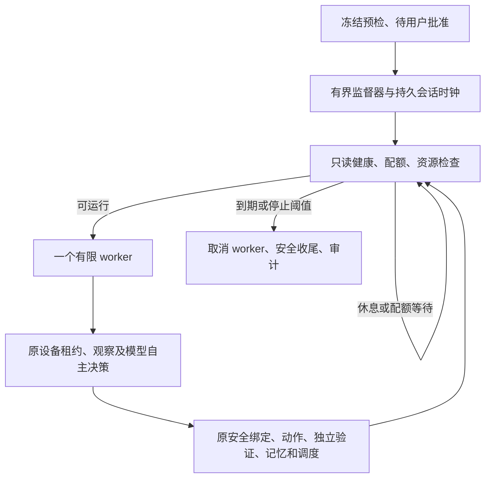

# v0.2.3 / Phase 1.2.2 有界长期运行架构

本阶段按 A（打包）→B（基础设施）→C（预检）→用户批准→D（真实 24h）→E（审计）执行。准备完成不代表 24 小时验收通过；`completed_duration` 只说明当前有限会话时间到达目标。当前状态及正式批准指纹以 `SOAK_PREFLIGHT.json` 为准。

## 执行与监督分离

`LongRunSoakController` 不发送手机动作或替模型选目标。它启动一次一周期的有限 Python worker，worker 复用 `AutonomousLife`、`PhoneLife`、`LifeState`、`RequestBudget`、共享设备租约和原能力/独立验证规则。原 `--forever` / `--soak-hours` 和常驻入口保持兼容，正式 24h 验收使用新增持久监督入口，不使用旧的进程内会话时钟。



监督器的 OS 文件锁防止同一会话双实例。不同会话、Benchmark 和原入口仍通过同一 `data/phone-life.sqlite3` 协调；不能 `--force` 抢占设备租约。监督器没有设备动作 API；ADB 健康探针只允许固定 get-state、QEMU 和 SDK getprop，不会 reconnect、点击、滑动或启动 App。

## 时钟、状态及重启

独立 `soak-control.sqlite3` 保存开始 UTC、墙钟、单调时钟、每次心跳、每 boot 身份、目标时长及配置指纹。进程重开继续使用原起点；不可用间隙计入 interrupted/process-unavailable，不重新获得 24h。单调钟倒退或系统重启身份改变会安全停止，不能据墙钟跳变虚构持续运行。

主状态至少有 running、sleeping、budget_wait、recovering、paused、emergency_stopped、interrupted、completed_duration、failed，另有 prepared、awaiting_approval、fault_backoff。状态持续时间是互斥分区，和总会话时间对账；设备不可用是可重叠的次级指标，不能再次加进总时长。实际执行时间指 worker 存活的墙钟时间（含 API/ADB 等待），不是 CPU 用时；采样存在约一秒量化误差。设备离线从首次只读确认后计时，不倒填先前未知区间。主动休息、强制休息、配额等待和失败退避分开。

每个 worker 开始先执行原中断审阅：取得租约、保留 unknown dispatch、生成新观察；发现 needs_review 时不会进入新目标。进程强杀最多有原租约 TTL 的等待，不抢占、不重放。自动 worker 崩溃重启最多三次，每次至少 30 秒退避。设备重上线只重新做只读检查，任何触屏仍需要模型新提议和原校验。

Pause/Resume 不重置全局时钟。EmergencyStop 对该会话不可逆；一般 Resume 不能让它自行恢复。全局期限、资源阈值或操作者停止会让 worker 取消原生命周期并释放租约；最多等待 60 秒收尾，必要时仅终止本监督器创建的 worker，未知动作保留待审阅。系统强制终止后的未知动作不会自动重试。

## 不可提高的 API 和动作预算

| 项目 | 硬上限 |
| --- | --- |
| 滚动小时请求 | 120 |
| 滚动 24h 请求 | 500 |
| 每目标请求 | 32 |
| 每目标动作 | 15 |
| 每目标时间 | 300 秒 |

可以配置更低值，超过上限会拒绝准备。所有实际 brain、GUI、verification、reflection 仍由原请求预约计数，失败和取消也消耗预算。监督器直接计算窗口恢复时间并等待，不反复请求。新增 `SoakAPI` 仅透传真实请求并保存哈希和提供商返回的有限 token 字段，没有响应替换或重试。未返回 usage 时保持 unknown；未配置可靠价格时费用为 null，不把请求次数当货币金额。

## 资源、证据与健康

默认新会话总证据预算 4 GiB，磁盘保留至少 5 GiB，Agent WAL 128 MiB，Agent DB 512 MiB，审计/JSONL 64 MiB，每个 Python 进程 RSS 512 MiB。每秒检查资源，健康事件默认每 5 秒采样，ADB 身份默认每 30 秒检查。超过阈值结束会话，不删除旧库、截图或失败轮次；阈值属于冻结配置。

默认不保存原图。`--private-evidence` 明确开启隔离模拟器私有截图/树；整个会话目录限制为当前用户和系统/管理员 ACL（POSIX 0700），普通其他账户不获访问，公共导出仍只用 allowlist。API 凭证只从既有 DPAPI 到进程内环境，不写入配置/日志。完整模型请求提示词不落盘；保留请求/上下文/响应哈希、记忆引用、token 统计和原 SQLite 审计。

健康记录包含进程存活、ADB/QEMU、租约、SQLite quick_check、请求失败、重复画面、唤醒安排、操作者状态、unknown/needs_review、磁盘/WAL/RSS。重复画面只是结构化警告，不强迫模型行动。数据库连接失败只做有界重新打开，不修复/重建数据。

`exported_cycles` 以 TaskRun ID 去重，`cycles.jsonl` 由该表原子派生，崩溃后可重建而不重复计数。逐周期保存目标/休息决策、来源、模型和恢复动作分别计数、验证、分阶段 API、语义质量、记忆/反思/兴趣变化、双时钟、失败原因和下次唤醒。源 SQLite 和失败材料不删；开放观察、休息和模型自评不会升级为 succeeded。

## 入口与批准

```powershell
# 只准备，不联网、不启动 Agent；目标目录必须是新的。
.\data\start-soak.ps1 -Action Prepare -Session data/soak-NEW -PrivateEvidence
.\data\start-soak.ps1 -Action Status -Session data/soak-NEW
# 用户明确批准该 SOAK_PREFLIGHT.json 指纹后才执行 Run。
.\data\start-soak.ps1 -Action Run -Session data/soak-NEW -ApproveFingerprint APPROVED_FINGERPRINT
.\data\start-soak.ps1 -Action Pause -Session data/soak-NEW
.\data\start-soak.ps1 -Action Resume -Session data/soak-NEW
.\data\start-soak.ps1 -Action EmergencyStop -Session data/soak-NEW
```

未提供正确批准指纹的正式 API 会话不会启动。几分钟预检与正式自然运行使用独立新库和不同 source_kind；故障注入只存在于离线或另行明确标记的受控测试，不能混入正式自然统计。原 v0.2.2 的受控 continuation 仍为受控证据，原自然错误样本仍为 NOT OBSERVED。

## 源码文件分工

| 文件 | 说明 |
| --- | --- |
| longrun_state.py | 持久时钟、状态、冻结配置、硬预算、进程锁 |
| longrun_health.py | 只读 DB/ADB/进程探针、资源限制与配额窗口 |
| longrun_api.py | 无注入真实传输的 usage、哈希和记忆引用审计 |
| longrun.py | 监督器、有限 worker、兼容生命周期、幂等逐周期导出 |
| data/start-soak.ps1 | 默认只读状态、显式准备/批准运行/控制、DPAPI 只读加载 |
| acceptance/evidence_metrics.py、verify_public.py | 随源码交付的统计和公开归档完整性检查 |
| acceptance/verify_continuation.py、source_archive.py | 私有/公开验证边界与干净解压回归 |
| acceptance/soak_preflight.py、soak_delivery.py | 仅数分钟真实预检、待批准配置、完整性复核及派生报告，不启动正式24h |
| tests/test_longrun.py、test_source_delivery.py | 时钟、预算、故障、来源隔离、停止与打包回归 |

原动作执行、安全策略、能力注册、语义处理、决策和持久化实现不变；生产旧文件只更新版本标识。实际改动与完整 SHA 以交付清单为准。24h Duration、Safety、Truthfulness、Integrity、Resource、Recovery、Autonomy、Memory、Operational 分别判定，不因计时到期自动全部通过。
