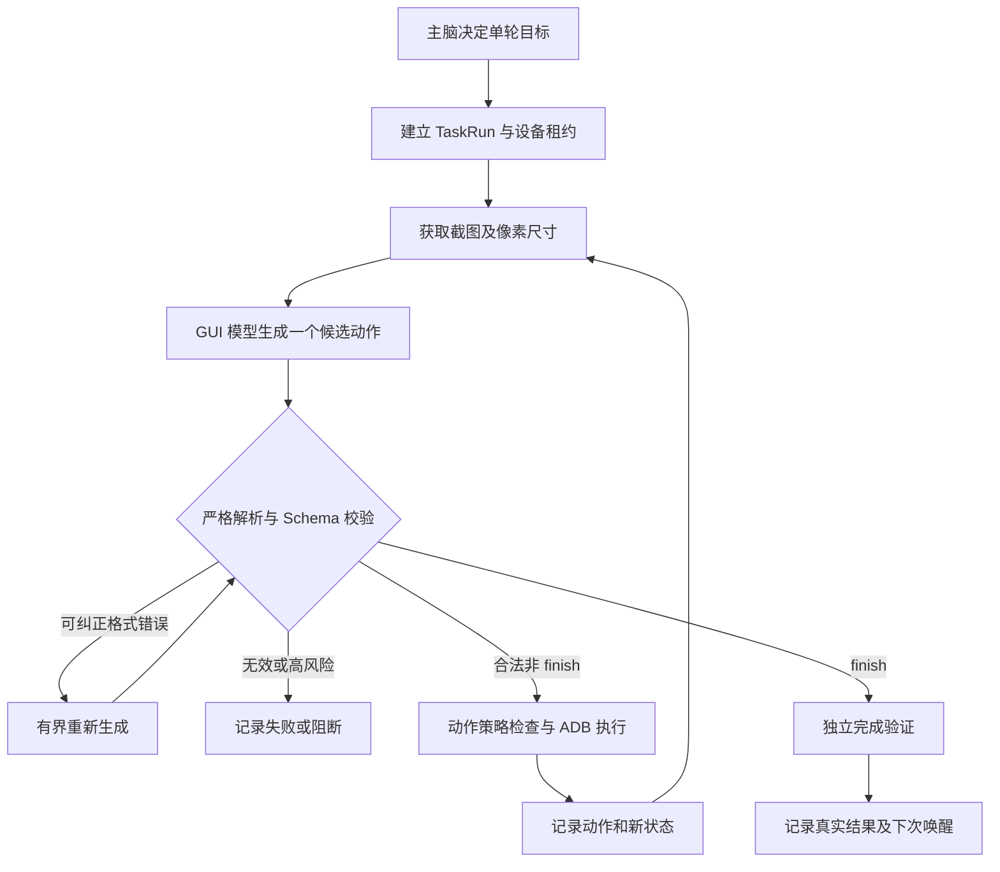

Proj.DigitalLife — Phase 1.1 GUI 执行可靠性开发文档
状态：READY FOR IMPLEMENTATION（开发规格，尚未实施）
编写日期：2026-10-19（Asia/Shanghai）
基线：v0.1.0 / Phase 1
依据：用户提交的 2026-10-19 测试报告（证据快照 12:40:51 +08:00）及本工作区的 Phase 1 源码
目标平台：Windows 11 / Python 3.13 / Android Emulator API 35；同时保留 Linux、Python 3.11+ 兼容性

0. 执行摘要
当前基础链路已接通：主脑规划、视觉截图请求、ADB 动作、SQLite 日志和自主调度。但固定 GUI 任务“打开关于手机并确认设备信息”没有通过。Phase 1.1 只解决 GUI 执行可靠性与可验证性，暂不添加 QQ、TTS、实体机自由控制、兴趣演化或新模型训练。

本阶段交付四个核心改动：
1. DL-T01：GUI 模型响应必须是唯一、符合 Schema 的动作；异常输出有界重试且绝不盲执行。
2. DL-T02：动作参数按截图实际尺寸和类型严格校验，记录精确的无效字段。
3. DL-T03：finish 仅表示执行器停止；业务目标是否达成必须独立验证。
4. DL-T04：每一轮具有可关联、可脱敏的审计轨迹，支持复现失败、恢复和基准测试。
**不可变安全原则：**模型输出永远是未经信任的数据；校验失败不能落到 ADB。不得靠正则截取第一个 JSON 来容忍多对象响应。不得让失败重试自动重放已经执行过的点击。
1. 基线事实与边界
1.1 已证实的事实
- Phase 1 现有 10 项单元测试通过；mock 的探索、休息、唤醒持久化链路通过。
- 模拟器 digitallife-api35（emulator-5582）和真实模型接口已接通；模型与 ADB 确实执行过动作。
- IT-06：执行 9 个动作后，后续 swipe 缺失或不合法的坐标触发 PolicyDenied。
- RT-02：第 4 个模型响应在 JSON 后追加说明和第二个 JSON 对象，json.loads 报 Extra data；动作未执行。
- Chrome 页面状态不确定时也记录了 completed，因此现有 completed 不等于目标成功。
- launch 的包名白名单不能限制通过 Home/点击/滑动进入系统设置，这是当前能力边界，不可描述成应用沙箱。
1.2 尚未验证
- 真实 GUI 任务成功率、跨天稳定性、掉线及限流恢复、真正的多进程竞争压测。
- 视觉模型本身的平均准确率；目前失败可能来自协议、坐标、导航、页面状态和模型能力多个因素。
- Windows 本机的完整证据目录未作为本次文档编写的输入附件提供；本规格引用报告中的事件编号与描述，不宣称已经重新检查证据文件或执行真实模拟器复测。
2. 总体设计

职责边界：
层	职责	不可做的事
Brain Planner	决定目标与休息时间	直接给 ADB 原始命令
GUI Planner	观察截图、提出一个动作	自行宣告经过验证的成功
Parser / Validator	唯一 JSON、类型及尺寸校验	猜测缺失坐标、执行动作
Action Policy	设备权限及风险边界	被 Prompt 绕过
Device Adapter	明确动作的单次执行及观察	自动重放失败前的动作
Goal Verifier	检查目标页面或事实证据	仅凭模型 finish 认定成功
Store	存储任务、尝试、步骤和最终状态	保存密钥和无限期原始隐私截图

3. 工作包 A：结构化输出（DL-T01 / P0）
A-1. 明确 GUI 动作协议
保留原有动作类型，但引入版本化、判别联合 Schema。每个模型响应只能包含 一个顶层 JSON 对象，并且该对象只能表示一个动作；禁止数组、多个对象、前后解释文字。对各动作设定必填字段：
动作	必填字段	备注
tap	type,x,y,reason	x,y 必须是整数
swipe	type,x,y,x2,y2,duration_ms,reason	四坐标必填
text	type,text,reason	继续沿用安全字符约束；不在本阶段扩权
launch	type,package,reason	继续由策略检查启动白名单
home / back	type,reason	无坐标
finish	type,outcome,reason	outcome = achieved / uncertain / cannot_proceed，只是执行器声明

模型输出示例：
{"type":"tap","x":365,"y":400,"reason":"打开设置搜索入口"}
{"type":"finish","outcome":"uncertain","reason":"未能确认目标页面"}
字段校验由程序完成，不接受数字字符串、null 坐标、未知动作、NaN、额外第二个 JSON 或超长文本。未知字段可由严格模式拒绝，或在版本迁移期明确记录并忽略；两种策略只能选择一种并写入测试。
A-2. API 格式约束与重试
- 如服务端确实支持，优先开启 response_format 的 JSON schema / JSON object 模式；先检查当前 DeepSeek 接口真实支持情况，不能凭假设发送不兼容字段。
- 仍用 json.loads 解析完整响应，不提取片段、不选第一个对象、不进行危险的“自动纠错执行”。
- 解析失败时可向同一 GUI 模型发送：原始任务、最新截图摘要、校验错误与原响应的限长摘录，要求生成单个全新动作。
- 最多进行 2 次格式修复（即每个 GUI 步骤最多 3 次模型生成）。重试期间截图和动作执行状态不变；不能重复执行前一步 ADB 动作。
- 仍失败返回专门的 MODEL_OUTPUT_INVALID 失败原因，并进入正常的任务收尾/退避路径。
- 网络超时、429、5xx 与无效 JSON 是不同错误类别；仅允许幂等的模型请求重试，不自动重试已确认发生的手机动作。
- 原始响应可能含敏感信息，应按日志政策脱敏后限长记录；不要记录完整 API 鉴权头。
4. 工作包 B：截图尺寸与动作校验（DL-T02 / P0-P1）
B-1. 引入 ScreenObservation
建议数据模型：
@dataclass(frozen=True)
class ScreenObservation:
    png: bytes
    width: int
    height: int
    sha256: str
    captured_wall_utc: str
    captured_monotonic_ns: int
    device_serial: str
截图宽高从实际 PNG 头（IHDR）解析，验证 PNG 签名及合理像素上限；也可使用已验证的图像库。每个动作要绑定生成该动作时的 observation_id，避免设备旋转后拿旧尺寸点击。

校验规则：
tap:   0 <= x < width  且 0 <= y < height
swipe: 四个坐标分别满足同一边界，100 <= duration_ms <= 1500
text:  维持现有字符/长度安全策略，不自动输入敏感凭据
不允许自动裁切越界坐标，不允许给缺失的 x2/y2 填默认值。必须返回结构化字段错误，例如：
{"code":"INVALID_COORDINATE","field":"y2","value":null,
 "expected":"integer in [0,1599]","screen":"720x1600"}
对可纠正的坐标错误允许最多 1 次动作重生成，并在重新生成前确认截图仍是当前画面；策略拒绝、敏感操作、超界重复输出时立即停止该目标。日志记录候选动作已被拒且未执行，不能与真实执行动作混淆。
B-2. 不要误用包名白名单
白名单只限制 launch。Phase 1.1 文档与日志都要保留这一事实；不能因为 Chrome 在白名单中就宣称所有后续触屏都不会进入其他应用。实体机依然按 Phase 1 的严格权限限制；模拟器使用隔离测试账号，不配置支付凭据。
5. 工作包 C：任务状态与完成验证（DL-T03 / P0）
C-1. 区分执行器停止与业务成功
建议替换/扩展 ExecutionResult，使用明确状态：
TaskStatus = Literal[
    "succeeded", "uncertain", "blocked", "failed", "step_limit"
]
- finish(outcome="achieved")：仅代表模型认为已达成；必须进入验证器。
- finish(outcome="uncertain")：返回 uncertain，无论理由多积极都不记成功。
- finish(outcome="cannot_proceed")：返回 blocked 或明确的 failed 子原因。
- 达到步数预算：step_limit，不可记成完成。
- 模型响应和设备错误：failed，具体 reason_code 进入结构化记录。
- Planner 决定 rest：另记为 rested 或 decision=rest 的调度事件，不参与 GUI 成功率分母。
历史数据库已有的 completed 不得批量改写成 succeeded；按 legacy_unverified 解释旧状态，保留原始事件与时间戳。
C-2. 独立 Goal Verifier
引入接口：
class GoalVerifier(Protocol):
    async def verify(self, goal: str, final_observation: ScreenObservation,
                     history: list[ActionRecord]) -> VerificationResult: ...

@dataclass(frozen=True)
class VerificationResult:
    verdict: Literal["verified", "not_met", "uncertain"]
    evidence: list[str]
    reason: str
针对固定测试目标“进入关于手机页并查看设备信息”，先提供专用验证器：
1. 任务后重新获取截图（不是直接复用动作前截图）。
2. 优先使用 UIAutomator 的文本/控件层级判断当前页面，或独立视觉判断；控件树失效时可用截图判断。
3. 验证当前确实是 About phone / 关于手机 页面，且能观察至少一个有效的设备信息字段；仅显示设置搜索页不能通过。
4. 若页面证据含糊，给出 uncertain，不能由执行模型自己的 reason 覆盖。
5. 把证据类型、判定理由和截图哈希关联到 TaskRun；不要求默认持久化原始截图。
通用目标暂无专门验证规则时，可保守返回 uncertain；不要假装视觉模型说完成就等于独立验证完成。
6. 工作包 D：可诊断事件与复放（DL-T04 / P1）
D-1. 事件字段
建议引入版本化 TaskRun / ActionAttempt / ActionRecord，但保持现有 events、memories、schedule、lease 表兼容：
字段	用途
task_run_id	一次完整目标执行的唯一 ID
step_index, generation_attempt	区分第几步和该步的第几次模型生成
observation_sha256, width, height	关联截屏，不必保留像素
candidate_action	经过脱敏的完整动作字段（坐标、时长、类型等）
validation_status, field_errors	候选动作合法与否及具体原因
execution_status	not_executed / executed / uncertain_after_transport_error
model_response_excerpt, response_sha256	诊断格式问题；长度有限、脱敏
api_request_id, provider, model	可追查 API 层而不泄漏令牌
wall_time_utc, monotonic_ns	分别用于墙钟排序与时延统计
task_status, verification_result	停止原因与业务判定

可选保留脱敏的原响应文件，限定大小（例如 4 KiB 摘要或可配置上限）、目录权限和保留周期；不得保存 API Key、Cookie、完整隐私屏幕、支付内容或未授权第三方聊天。测试时可显式开启隔离 AVD 的截图证据模式。
D-2. 可复放范围
- 默认“复放”应是 dry-run：从历史响应重建解析、校验和状态转移，不能再次向手机发送点击。
- 真机或模拟器动作再执行需要独立确认、明确设备序列号和干净的初始状态。
- 直接调用 execute_goal 的定向测试必须拥有独立 TaskRun，在 try/finally 中释放租约，并由统一包装层持久化结果；不得回填成另一个 run_once 的成功。
- 保留报告事件 18—43 及 2026-10-19 原始证据，不覆盖、不清空旧 SQLite。新增表采用向前兼容的迁移并测试旧库读取。
7. 错误恢复、预算和并发
1. 一个 GUI 步骤允许多次模型生成，但只有成功校验的一个动作能进入 ADB 执行。
2. 每个动作建立 attempt_id；执行前记录候选，执行后记录结果。若 ADB 超时且无法确认设备是否已执行，标记 uncertain_after_transport_error，先重新观察屏幕，不能直接重发点击。
3. 单目标步数预算仍为默认 15；格式重试次数单独计入 API 调用预算，不增加已执行动作数。
4. 模型错误超过阈值进入 600 秒或更保守的退避；应记录下次唤醒，避免失败风暴。
5. run_once 和定向测试共用同一租约与安全执行包装层；--force 只能忽略唤醒时间，不能绕过租约。
6. 使用单调时间记录步骤耗时；不要从可跳变的系统墙钟差值推断八小时稳定运行。
7. 本阶段不引入自动并行控制两台设备；每设备一个执行者，外层可独立调度。
8. 源码修改清单
文件 / 新模块	修改内容
src/phonelife/models.py	带 Schema 的 Action、finish outcome、TaskStatus、VerificationResult
src/phonelife/llm.py	严格单对象解析、服务端格式能力探测、模型生成重试与可诊断错误
src/phonelife/policy.py	按实际屏幕尺寸验证坐标、明确必填字段和拒绝原因
src/phonelife/devices.py	ScreenObservation、截图尺寸及哈希、执行结果和异常标记
src/phonelife/loop.py	执行停止与验证分离、错误预算、统一 TaskRun 生命周期
src/phonelife/storage.py	兼容迁移、步骤/尝试/验证记录、旧完成状态保留
src/phonelife/verification.py（新）	GoalVerifier 与“关于手机”专用检查器
src/phonelife/cli.py	安全的定向复测入口和明确退出状态；兼容原 CLI
tests/	详见测试矩阵，持续保留现有 10 项测试
docs/	更新协议、执行轨迹、运行与故障排查文档

不要在一次改动中重构整个自主 Agent。建议拆为 3 个可独立审查的变更集：
- Change A / Contract：JSON、Action Schema、截图尺寸与校验测试。
- Change B / Outcome：结果状态、GoalVerifier、统一 TaskRun、数据库兼容迁移。
- Change C / Integration：脱敏轨迹、定向测试、真实模拟器复验、运维文档。
9. 自动化测试矩阵
除原有 10 项必须全绿外，至少新增：
ID	输入与故障	期望
P11-01	单个合法动作 JSON	解析通过
P11-02	JSON 后跟解释文字	拒绝，不执行动作
P11-03	连续两个 JSON 对象	拒绝；有界重生成，不选第一个
P11-04	JSON 数组或错误类型	拒绝
P11-05	swipe 缺失 x2 或 y2	返回对应字段错误，ADB 0 次
P11-06	坐标越过 720×1600 截图边界	拒绝，不裁切
P11-07	截图方向变化后使用旧坐标	重新观察或拒绝
P11-08	格式修复首次成功	只执行 1 次动作
P11-09	格式修复 2 次仍失败	任务 failed，停止模型生成
P11-10	finish(uncertain)	返回 uncertain，非 succeeded
P11-11	finish(achieved) 但仍在搜索页	验证不通过，非 succeeded
P11-12	真正进入关于手机并有设备信息字段	succeeded，附证据
P11-13	策略拒绝的敏感动作	blocked，ADB 0 次
P11-14	ADB 超时，动作是否执行未知	不盲重试，先重新观察
P11-15	execute_goal 定向异常	持久化失败结果并释放租约
P11-16	旧库有 completed 事件	保持原值，不误算成功率
P11-17	API 故障进入退避	下次唤醒持久化，不紧密重试
P11-18	日志包含密钥/敏感文本样本	脱敏、限制长度
P11-19	两个进程争同一设备	第二执行者拿不到租约
P11-20	复放历史 TaskRun	默认不发任何 ADB 动作

所有新用例尽量使用 Mock API / Mock Phone，避免依赖在线模型而形成不稳定 CI。
10. 真实模拟器复验协议
**固定目标：**在 Android 15 模拟器中打开系统设置的 About phone（关于手机）页面，读取至少一个设备信息字段后结束。

复验前：
1. 保存源代码修订号或源码 SHA-256 清单；确认虚拟机与 ADB 在线。
2. 备份 SQLite；确认历史 test-evidence/2026-10-19 不被覆盖。
3. 前台确认设备空闲，常驻 Agent 不正在控制模拟器；不应通过 --force 绕过租约。
4. 记录模型 ID、API 路由、屏幕尺寸、步数预算、格式重试预算和校验器版本。
5. 每次从预先定义的可复现初始画面/状态开始，记录重置方式。
执行至少 20 次 定向测试，每次记录：合法模型响应率、总 API 次数、实际 ADB 动作数、最终页面、验证状态、失败原因、单调计时耗时。可把“≥18/20 经最终截图/控件验证成功、0 次假成功、0 次未经授权高风险动作”作为本阶段的初步工程门槛；20 次样本不足以宣称长期无人值守稳定性。

不把 model finish、CLI 退出码 0、API stderr 为空、后台进程存活当作业务完成证据。
11. Definition of Done（合并门槛）
- [ ] 原有 10 项单元测试保持通过；新增测试全部通过。
- [ ] DL-T01 多 JSON 和尾随解释被拒绝；有限重试不导致重复 ADB 操作。
- [ ] DL-T02 缺失/越界坐标可定位到字段；截图尺寸来自真实图像。
- [ ] DL-T03 所有成功状态有独立验证证据；uncertain 不记成功。
- [ ] DL-T04 每个 TaskRun 能关联候选响应、校验结果、执行动作与最终截图哈希。
- [ ] 旧 SQLite 与证据保留；迁移和异常退避有自动测试。
- [ ] 实体机的保守权限仍然生效；模拟器仍采用隔离账号。
- [ ] 20 次固定任务复验达到初步工程门槛，并附可审查结果及失败样本。
- [ ] 本次结果只标注为 Phase 1.1 GUI Reliability，不夸大为“长期稳定自主 Agent 已验收”。
12. 不在本阶段实现的事项
- QQ/NapCat 主动发消息、TTS、独立聊天人格改进。
- 长期兴趣权重、向量数据库、跨天目标规划。
- 实体手机无限制坐标操作、权限绕过、支付等不可逆操作。
- 自动修改 Prompt 以解除策略限制、通用自动点击高风险授权弹窗。
- 在没有固定验收协议的情况下，将某次成功推广为整体 GUI 成功率。
13. 开发交接要求
完成者应交付：
1. 变更文件清单及接口兼容性说明。
2. 单元测试与定向集成测试输出（包括失败用例）。
3. SQLite 迁移策略和不丢历史数据的验证。
4. 20 次真实模拟器复验的逐次结果、证据摘要及总体统计。
5. 仍未修复的风险、后续 Phase 1.2 建议。
优先级准则：先解决“动作协议正确与成功状态可信”，再优化完成率，最后才扩大自主活动范围。